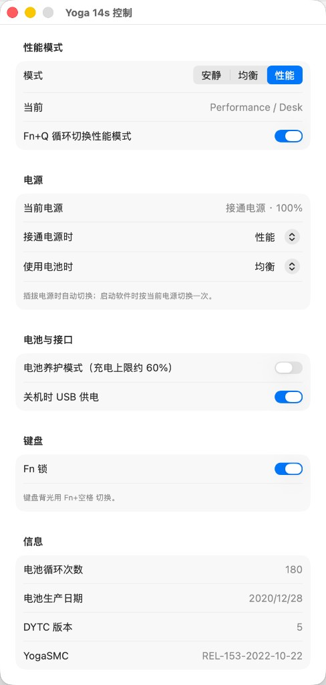
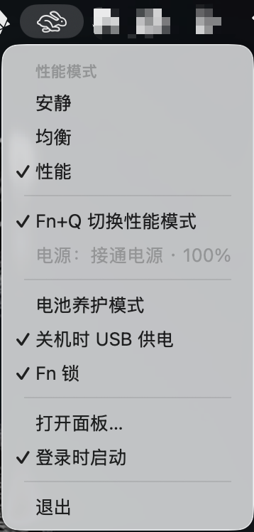
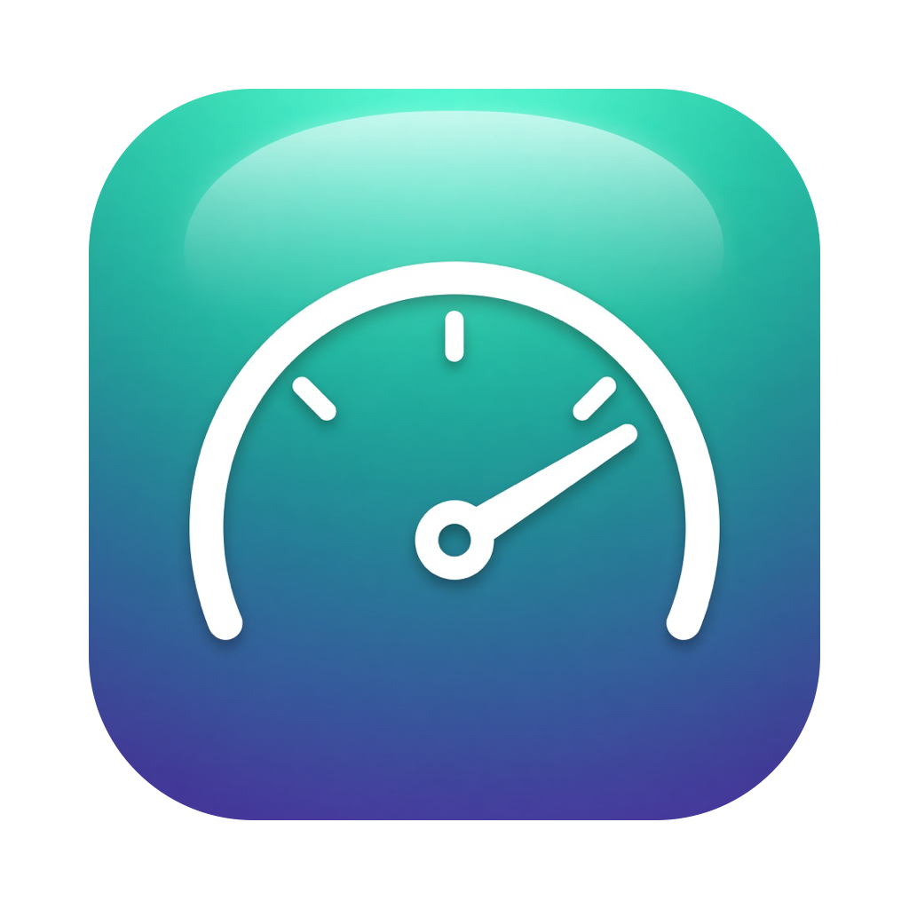

# YogaControl





菜单栏程序，窗口标题为「Yoga 14s 控制」。给加载了 [YogaSMC](https://github.com/zhen-zen/YogaSMC) 的联想 IdeaPad / Yoga 使用，用来替代 `YogaSMCPane.prefPane`。原版面板在 macOS Tahoe 上大部分控件已经不能用。



在联想 Yoga 14s ACH 2021（Ryzen 7 5800H）上验证。macOS Tahoe **26.7.2**，YogaSMC **1.5.3**。版本 1.0。

## 1. 功能

状态栏图标随性能模式变化：安静是乌龟，均衡是仪表盘，性能是兔子。菜单可以设置：

- **性能模式**：安静 / 均衡 / 性能（联想 DYTC）。
- **Fn+Q 切换性能模式**：默认打开，可关闭。设置记在 `UserDefaults` 的 `FnQEnabled`。
- **电池养护模式**：充电上限约 60%。
- **关机时 USB 供电**。
- **Fn 锁**。
- **打开面板…**：与菜单相同的设置，另显示当前电源、电池循环次数、电池生产日期、DYTC 版本和 YogaSMC 版本。
- **登录时启动**。

**按电源自动切换。** 面板「电源」显示当前是否接通电源、是否在充电，以及电量百分比。可分别设置「接通电源时」和「使用电池时」的性能模式，或选「不自动切换」。程序启动时按当前电源切换一次；之后只在插上或拔掉电源时切换，不按电量做定时检查。用 Fn+Q 或菜单改过的模式会保持到下次插拔。

手动打开程序，或在它运行时再次点击程序图标，会弹出面板。关闭窗口、在 Dock 中右键「退出」，以及 Command-Q，都只回到状态栏，程序继续运行。状态栏菜单里的「退出」才会结束程序。

勾选「登录时启动」后，登录时只显示状态栏图标，不弹出面板。登录项写在 `~/Library/LaunchAgents/local.yoga14s.YogaControl.plist`，标签 `local.yoga14s.YogaControl`，启动参数 `--launched-at-login`，程序路径为 `/Applications/YogaControl.app`。

**Fn+Q** 按安静 → 均衡 → 性能 → 安静循环，屏幕上短暂显示当前模式。按键由 YogaSMC 以 VPC 事件转发（event `0`，data `0x40` 或 `0x01`）。YogaControl 通过 YogaSMC 用户客户端接收，因此程序需要处于运行状态。

开机时的模式由 BIOS 决定。本程序只在系统运行中切换 DYTC 模式，不提高固件功耗上限。Yoga 14s ACH 2021 上 16 线程满载：

| 模式 | 封装功耗 | 全核频率 |
| --- | --- | --- |
| 安静 | 约 12 W | 约 1.5 GHz |
| 均衡 | 约 24 W | 约 2.7 GHz |
| 性能 | 约 40 W | 约 3.7 GHz |

封装功耗含核显。机身热透后，性能模式持续约 32–36 W / 2.4–2.7 GHz（约 86 °C）。

## 2. 依赖

- macOS 15 或更高。`LSMinimumSystemVersion` 为 15.0。
- 已加载 `YogaSMC.kext`，I/O Registry 中有 `IdeaVPC`。确认：`ioreg -rn IdeaVPC -d1`。
- 命令行工具（`xcode-select --install`）。不需要完整的 Xcode。

## 3. 编译和安装

```bash
./build.sh
cp -R build/YogaControl.app /Applications/
open /Applications/YogaControl.app
```

`build.sh` 用 `swiftc` 编译 `YogaControl.swift`，生成 `Info.plist`（`LSUIElement`，平时不显示 Dock 图标），复制 `AppIcon.icns`，并做 ad-hoc 签名。`build/` 是编译产物，不纳入版本库。

## 4. 与 YogaSMC 的接口

每 2 秒用 `IORegistryEntryCreateCFProperties` 读取 `IdeaVPC`。写入使用 `IORegistryEntrySetCFProperty`，由 YogaSMC 的 `setPropertiesGated` 处理。不需要 root，也不需要辅助程序。

| 设置 | 属性名 | 取值 |
| --- | --- | --- |
| 性能模式 | `DYTCMode` | 字符串 `Q`、`B` 或 `P` |
| 电池养护 | `ConservationMode` | 布尔 |
| 关机 USB 供电 | `AlwaysOnUSBMode` | 布尔 |
| Fn 锁 | `FnlockMode` | 布尔 |

读取时，当前模式来自 `DYTC` 字典的 `PerfMode`（`Quiet` / `Balance` / `Performance`）和 `FuncMode`，版本来自 `Revision`。电池循环次数和生产日期来自 `Battery 0`。驱动版本来自 `VersionInfo`。

## 5. 没有包含的功能

- **快速充电**：本机固件不接受该命令。YogaSMC 1.5.3 的 `IdeaVPC::toggleRapidCharge` 还会把状态发到 `conservationMode`，而不是 `rapidChargeMode`；原版面板也没有对应处理。
- **键盘背光**：YogaSMC 在这台机器上报告不支持。用 Fn+空格 切换。

## 6. 图标

`icon-source.jpg` 为源图。`make-icon.swift` 去掉白底、裁成正方形，并按 macOS 图标边距输出 `icon.png`。重新生成 `AppIcon.icns`：

```bash
swiftc -O -o /tmp/make-icon make-icon.swift
/tmp/make-icon icon-source.jpg icon.png
mkdir -p /tmp/AppIcon.iconset
for s in 16 32 128 256 512; do
  sips -z $s $s icon.png --out /tmp/AppIcon.iconset/icon_${s}x${s}.png
  sips -z $((s*2)) $((s*2)) icon.png --out /tmp/AppIcon.iconset/icon_${s}x${s}@2x.png
done
iconutil -c icns /tmp/AppIcon.iconset -o AppIcon.icns
```
